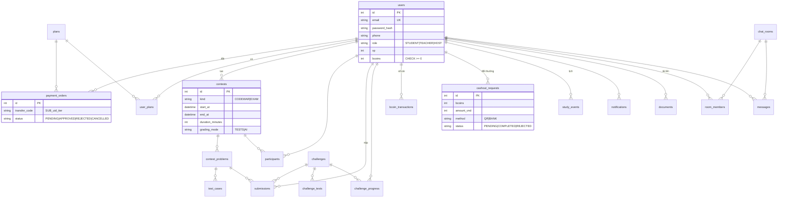

# CodeChalk Platform — Phân tích & Kiến trúc

Tài liệu này mô tả cách nền tảng được dựng theo bản đặc tả "Phát triển nền tảng lập trình & học tập trực tuyến" (mục I–XI).

## 1. Tổng quan

```
Trình duyệt (index.html: trang học + IDE + Robot + giao diện nền tảng)
   │  REST /api/*  (JWT Bearer)          WebSocket /ws/notify, /ws/rooms/{id}
   ▼
FastAPI (app/main.py) ── routers/ ── services/ ── SQLAlchemy ── PostgreSQL (hoặc SQLite khi chạy thử)
   │                         │
   │                         ├─ judge.py → local | docker (judge/Dockerfile) | Judge0
   │                         ├─ ai.py    → Gemini | Claude | OpenAI (khoá nằm trên server)
   │                         ├─ mailer.py→ SMTP (Gmail App Password)
   │                         └─ scheduler.py (vòng lặp 20 giây: nhắc lịch, chốt phòng thi)
   └─ data/uploads/ (tài liệu, ảnh chat, ảnh QR nhận tiền)
```

| Đặc tả gợi ý | Đã chọn | Lý do |
|---|---|---|
| Next.js + Tailwind + Monaco | Trang HTML đơn có sẵn của CodeChalk + trình soạn code riêng | Giữ nguyên giao diện, Lớp học C++/Python và Robot đã làm; một file, mở được ngay |
| NestJS / FastAPI | **FastAPI** | Cùng ngôn ngữ với máy chấm Python, async + WebSocket sẵn |
| PostgreSQL / MongoDB | **PostgreSQL** (SQLite khi chạy thử) | Giao dịch Bcoins cần ACID và khoá dòng |
| Socket.io | WebSocket chuẩn (Starlette) | Không cần thư viện phía trình duyệt |
| JWT + bcrypt | PyJWT HS256 + bcrypt | Như đặc tả |
| Zod / Joi | Pydantic v2 | Kiểm tra dữ liệu ngay ở tầng API |
| Docker / Judge0 | Cả hai + chế độ local | `JUDGE_MODE` trong `.env` |

## 2. Vai trò & quyền

| Hành động | Khách | SINH VIÊN | GIÁO VIÊN | HOST |
|---|:-:|:-:|:-:|:-:|
| Học Lớp học, Phòng luyện, Robot (khoá riêng) | ✓ | ✓ | ✓ | ✓ |
| Xem Challenge chương 1–5 | ✓ | ✓ | ✓ | ✓ |
| Nộp bài, Code War, Forum, Tài liệu, Lịch | | ✓ | ✓ | ✓ |
| Tạo phòng Code War | | ✓ | ✓ | ✓ |
| Tạo Bài kiểm tra | | | ✓ | ✓ |
| Chế độ AI CHẤM khi tạo phòng | | gói Lớp học | ✓ | ✓ |
| Duyệt thanh toán, đổi TAG, sửa tài khoản, xác nhận đổi thưởng | | | | ✓ |

Tài khoản HOST được tạo một lần khi khởi động từ `HOST_EMAIL`, `HOST_PASSWORD`, `HOST_PHONE` trong `.env` (mật khẩu được băm bcrypt, không nằm trong mã nguồn). Đăng ký mới luôn nhận vai trò SINH VIÊN.

## 3. Gói (phiên bản)

| Mã | Tên | Giá mặc định | Quyền |
|---|---|---|---|
| `TU_HOC` | Tự học | 0đ | Challenge chương 1–5, 20 lượt AI/ngày |
| `ON_THI` | Ôn thi | 59.000đ / 30 ngày | Mở cả 13 chương, 300 lượt AI/ngày |
| `LOP_HOC` | Lớp học | 19.000đ / tài khoản / 30 ngày | Như Ôn thi + dùng AI CHẤM khi tạo phòng |

HOST sửa giá, thời hạn, mô tả trong **Quản trị → Gói**.

### Luồng thanh toán VietQR

```mermaid
sequenceDiagram
  participant U as Người dùng
  participant S as Server
  participant H as HOST
  U->>S: POST /api/payments/orders {plan_id}
  S-->>U: Đơn PENDING + mã QR (EMVCo, BIN 970415) + nội dung SUB_{USER_ID}_{TIER_ID}
  U->>U: Quét QR bằng app ngân hàng, chuyển khoản
  H->>S: Kiểm tra sao kê, POST /api/admin/payments/{id}/approve
  S->>S: Tạo UserPlan (cộng dồn thời hạn), đơn APPROVED
  S-->>U: Thông báo chuông + email; modal QR tự đóng
```

Mã QR được dựng ngay trên server theo chuẩn NAPAS/EMVCo (tag 38 GUID `A000000727`, dịch vụ `QRIBFTTA`, tag 62/08 là nội dung chuyển khoản, CRC16-CCITT), không phụ thuộc dịch vụ ngoài.

## 4. CODE WAR & Bài kiểm tra

Trạng thái phòng tính theo thời gian: `UPCOMING` (trước `start_at`), `ONGOING`, `DONE` (sau `end_at`).

- **JOIN**: tạo `Participant` với `deadline_at = min(end_at, joined_at + duration_minutes)`, nên mỗi người có đúng thời lượng làm bài.
- **Chạy thử**: chỉ chạy test mẫu, không tính điểm.
- **Nộp bài**:
  - NGƯỜI CHẤM: chạy toàn bộ test. Điểm của bài = điểm tối đa × tỉ lệ trọng số test đúng.
  - AI CHẤM: chạy test mẫu trước, sau đó AI chấm theo thang Đúng 60%, Hiệu quả 25%, Code sạch 15%, kèm nhận xét tiếng Việt.
- **Điểm người chơi**: tổng điểm cao nhất của từng bài. `last_improve_at` là lúc điểm tăng lần cuối.
- **Xếp hạng**: điểm giảm dần, bằng điểm thì ai có `last_improve_at` sớm hơn xếp trên.
- **Chốt (DONE)**: bộ lập lịch gọi `finalize` một lần duy nhất (`finalized_at`). Top 10 nhận Bcoins theo `CODEWAR_REWARDS` / `EXAM_REWARDS` (mặc định 10, 9, …, 1; Top 1 Bài kiểm tra = 10 Bcoins).

### Chống "cày" Bcoins

1. Người có 0 điểm không nhận thưởng.
2. Code War phải có ít nhất `CODEWAR_MIN_PLAYERS` (mặc định 3) người có điểm mới trả Bcoins, để tránh tự tạo phòng một mình.
3. Người tạo phòng Code War không nhận thưởng phòng của chính mình.
4. Mỗi phòng chỉ chốt một lần; Bcoins ghi vào sổ cái `bcoin_transactions` (số dư sau giao dịch, lý do, tham chiếu), không bao giờ âm (ràng buộc CHECK + khoá dòng `SELECT … FOR UPDATE`).

## 5. Bảng xếp hạng chung

`GET /api/leaderboard?by=xp|bcoins`. Trang tự làm mới 15 giây/lần. XP có được khi:

- AC lần đầu một bài thi: +20.
- AC lần đầu một bài Challenge: + XP của bài (theo độ khó).

## 6. Thời khoá biểu & nhắc lịch

`StudyEvent` có `repeat` NONE/DAILY/WEEKLY, `remind_minutes`, bật/tắt chuông và email. Bộ lập lịch (`SCHEDULER_SECONDS`) tìm sự kiện có `next_remind_at ≤ now`, gửi thông báo qua WebSocket `/ws/notify` và email SMTP, rồi tính lần nhắc kế tiếp. Chạy bên trong tiến trình server nên không cần cron riêng.

## 7. Kho tài liệu

Tải lên: pdf, doc/docx, ppt/pptx, xls/xlsx, csv, zip/rar/7z, ảnh, mã nguồn (tối đa `MAX_UPLOAD_MB`). Server kiểm tra phần mở rộng và chữ ký byte đầu tệp, lưu bằng tên ngẫu nhiên. PDF và ảnh xem trực tuyến được; lượt tải được đếm.

## 8. Shop đổi Bcoins

- Mốc đổi: 100, 200, …, 1000 Bcoins. 100 Bcoins = 10.000đ (`BCOIN_RATE_VND=100`).
- Hình thức nhận: ảnh QR hoặc số tài khoản + ngân hàng + chủ tài khoản.
- Bấm Gửi sẽ **trừ Bcoins ngay** và tạo phiếu PENDING.
- HOST bấm "XÁC NHẬN ĐÃ CHUYỂN TIỀN" → COMPLETED. Nếu từ chối: REJECTED và hoàn Bcoins kèm lý do.

## 9. Forum

Phòng có tên, ảnh đại diện, mô tả. Tham gia rồi mới đọc và gửi được. WebSocket `/ws/rooms/{id}` mang các sự kiện:

- `message`: tin nhắn mới.
- `typing`: đang soạn.
- `read`: đã xem, kèm `last_read_id` của từng người.
- `presence`: ai đang online.
- `member`: vào hoặc rời phòng.

Ảnh và tệp gửi qua REST multipart. Danh sách thành viên có chấm online.

## 10. CHALLENGE

`data/challenges.json` chứa 929 bài trích từ tài liệu "1000 bài code thiếu nhi" (tài liệu thực tế có 929 bài, đánh số đến 1000 nhưng có các khoảng trống), chia 13 chương, sắp từ dễ đến khó.

| Chương | Chủ đề | Số bài | Có bộ test |
|--:|---|--:|--:|
| 1 | Lưu đồ thuật toán | 76 | 76 |
| 2 | Lập trình với ngôn ngữ C | 5 | 4 |
| 3 | Các cấu trúc điều khiển | 33 | 32 |
| 4 | Hàm | 7 | 6 |
| 5 | Mảng một chiều | 189 | — |
| 6 | Ma trận | 118 | — |
| 7 | Ma trận vuông | 46 | — |
| 8 | Trừu tượng hoá dữ liệu | 146 | — |
| 9 | Mảng cấu trúc | 81 | — |
| 10 | Đệ quy | 67 | 60 |
| 11 | Kỹ thuật lập trình con trỏ | 9 | — |
| 12 | Danh sách liên kết | 83 | — |
| 13 | Cây nhị phân | 69 | — |

- Bài có bộ test: chấm tự động (AC/WA/TLE/RE/MLE/CE, điểm theo số test đúng).
- Bài chưa có test: AI chấm. Bài được tính "đã giải" khi điểm ≥ 80 và độ đúng ≥ 80.
- Thêm test dần: sửa `data/challenges.json` rồi chạy `python scripts/load_challenges.py`.
- Trợ lý AI của bài (`POST /api/challenges/{id}/ai`), 6 chế độ, mỗi lần gọi tính 1 lượt AI/ngày:

  | Chế độ | Nội dung | Ảnh hưởng XP |
  |---|---|---|
  | `HINT` | gợi ý hướng làm, không có code | không |
  | `SUGGEST` | khung code, phần lõi để `TODO` | không |
  | `DEBUG` | chỉ dòng lỗi và nguyên nhân | không |
  | `EXPLAIN` | giải thích code đang viết | không |
  | `FIX` | sửa tối thiểu trên code người học | giải xong còn 50% XP |
  | `SOLUTION` | code đáp án hoàn chỉnh | giải xong không cộng XP |

- Với `FIX` và `SOLUTION`, server tách khối code trong câu trả lời và chạy trên toàn bộ test của bài (máy chấm thật).
  - Sai: gửi lại cho AI kết quả chạy (lỗi biên dịch, test mẫu sai kèm dữ liệu, test ẩn chỉ báo trạng thái) để AI sửa một lần, rồi giữ bản tốt hơn.
  - Kết quả kiểm chứng (`passed/total`) hiện cạnh code.
- Đáp án đúng hết test được lưu vào `challenge_solutions` theo (bài, ngôn ngữ) và dùng lại cho mọi người, không tốn lượt AI.
- Mức trợ giúp đã dùng trước khi giải được lưu trong `challenge_help` (FIX < SOLUTION). Máy chấm đọc bảng này khi cộng XP lần giải đầu tiên.

## 11. Máy chấm

| Chế độ | Cách chạy | Khi nào dùng |
|---|---|---|
| `local` | Tiến trình con trên máy chủ, giới hạn CPU/bộ nhớ/kích thước tệp (Linux), môi trường biến đã lọc sạch khoá bí mật | Thử nghiệm một mình |
| `docker` | Mỗi lượt nộp một container `codechalk-judge`: không mạng, `--read-only`, user 65534, `--cap-drop ALL`, giới hạn CPU/RAM/PID | **Có người dùng thật** |
| `judge0` | Gọi API Judge0 CE | Đã có máy Judge0 |

So sánh output theo token: bỏ qua khoảng trắng thừa và dòng trống cuối; số thực có sai số 1e-5.

## 12. Cơ sở dữ liệu



## 13. API

Tài liệu tương tác: mở `http://localhost:8000/docs` khi server chạy.

| Nhóm | Endpoint |
|---|---|
| Tài khoản | `POST /api/auth/register` · `POST /api/auth/login` · `GET/PATCH /api/auth/me` · `POST /api/auth/password` |
| Gói & thanh toán | `GET /api/plans` · `GET /api/plans/me` · `GET/POST /api/payments/orders` · `POST /api/payments/orders/{id}/cancel` |
| HOST | `GET /api/admin/stats` · `GET /api/admin/users` · `PATCH /api/admin/users/{id}` · `POST /api/admin/users/{id}/grant` · `GET /api/admin/payments` · `POST /api/admin/payments/{id}/approve|reject` · `PATCH /api/admin/plans/{id}` · `GET /api/admin/cashouts` · `POST /api/admin/cashouts/{id}/complete|reject` · `GET /api/admin/bcoins` |
| Code War / Kiểm tra | `GET/POST /api/contests` · `GET/PATCH/DELETE /api/contests/{id}` · `POST /api/contests/{id}/problems` · `PUT/DELETE /api/contests/{id}/problems/{pid}` · `POST …/tests` · `DELETE …/tests/{tid}` · `POST /api/contests/{id}/join` · `POST …/problems/{pid}/run|submit` · `GET /api/contests/{id}/leaderboard` · `GET /api/contests/{id}/submissions` · `GET /api/submissions/{id}` |
| Bảng xếp hạng | `GET /api/leaderboard?by=xp|bcoins` |
| Lịch & thông báo | `GET/POST /api/events` · `PUT/DELETE /api/events/{id}` · `GET /api/notifications` · `POST /api/notifications/{id}/read` · `POST /api/notifications/read-all` · `WS /ws/notify` |
| Tài liệu | `GET /api/documents/categories` · `GET/POST /api/documents` · `GET /api/documents/{id}/file` · `DELETE /api/documents/{id}` |
| Shop | `GET /api/shop/tiers` · `GET /api/bcoins/me` · `GET /api/shop/requests` · `POST /api/shop/cashout` · `GET /api/shop/requests/{id}/qr` |
| Forum | `GET/POST /api/rooms` · `GET/DELETE /api/rooms/{id}` · `GET /api/rooms/{id}/avatar` · `POST /api/rooms/{id}/join|leave|read` · `GET/POST /api/rooms/{id}/messages` · `GET /api/messages/{id}/file` · `WS /ws/rooms/{id}` |
| Challenge | `GET /api/challenges/chapters` · `GET /api/challenges` · `GET /api/challenges/{id}` · `POST /api/challenges/{id}/run|submit` · `GET /api/challenges/{id}/submissions` |
| AI | `GET /api/ai/status` · `POST /api/ai/tutor` (phòng thi) · `POST /api/ai/complete` (Robot) · `POST /api/challenges/{id}/ai` · HOST: `GET/PUT /api/admin/ai` · `POST /api/admin/ai/models` · `POST /api/admin/ai/test` |
| Hệ thống | `GET /api/health` |

## 14. Bảo mật

- Mật khẩu: bcrypt, 8–72 byte. JWT HS256 ký bằng `JWT_SECRET`; production từ chối chạy với chuỗi mặc định.
- Dữ liệu vào được kiểm tra bằng Pydantic:
  - email;
  - số điện thoại Việt Nam `^(0|\+84)(3|5|7|8|9)\d{8}$`;
  - thời gian phải có múi giờ;
  - mốc đổi thưởng.
- Tệp tải lên: whitelist đuôi tệp + kiểm tra chữ ký byte, tên lưu ngẫu nhiên, header `nosniff`.
- Khoá AI (trong `.env` hoặc bảng `app_settings` do HOST nhập ở Quản trị → AI; API chỉ trả về 4 ký tự cuối), mật khẩu SMTP, `DATABASE_URL` chỉ nằm trên server. Code thí sinh chạy với biến môi trường đã lọc.
- Bcoins: mọi thay đổi đi qua `services/bcoins.change()` với khoá dòng và sổ cái.

## 15. Kiểm thử

```
pip install -r requirements-dev.txt
pytest -q tests
```

13 kịch bản bao trọn: đăng ký/đăng nhập, quyền HOST, thanh toán, bài kiểm tra, Code War (ngưỡng người chơi), đổi thưởng + hoàn tiền, tài liệu, Forum WebSocket, lịch nhắc, thông báo WebSocket, bảng xếp hạng, Challenge (khoá chương, chấm test, chấm AI), health.

## 16. Triển khai

| Cách chạy | Lệnh | Dùng khi |
|---|---|---|
| Thử trên máy (SQLite, chấm local) | `run_dev.bat` / `run_dev.sh` | Một mình phát triển |
| Docker trên máy (PostgreSQL, chấm trong container) | `docker_start.bat`, `docker_public.bat` (link trycloudflare tạm) | Cho bạn bè dùng thử |
| VPS + tên miền (Caddy HTTPS) | `deploy_vps.bat` → `deploy/setup_vps.sh`; cập nhật `deploy_update.bat` | Chạy thật 24/7 tại một địa chỉ cố định |

Trên VPS, các luồng đi như sau:

```
Internet ──443/80──▶ Caddy (HTTPS, Let's Encrypt) ──▶ app:8000 ──▶ db (PostgreSQL, không mở cổng)
                                                        └─docker.sock─▶ container chấm bài (không mạng, volume-subpath)
```

- Cổng 8000 chỉ gắn vào `127.0.0.1` (`APP_BIND`).
- Tường lửa UFW chỉ mở 22, 80 và 443; fail2ban bảo vệ SSH.
- Sao lưu `pg_dump` cùng thư mục tải lên chạy mỗi ngày qua cron, giữ 14 ngày (`deploy/backup.sh`).
- Khôi phục bằng `deploy/restore.sh`.
